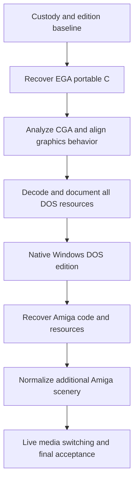

# Test Drive II development roadmap

Planning baseline: 13 October 2026. This roadmap preserves the user's requested order. The user subsequently authorized Phase 0 and Phase 1, TD2EGA first. Phase 0 is complete and Phase 1 is in progress; see the [current recovery checkpoint](../recovery/README.md) and task-specific status in `backlog.json`. Later phases and integrated gameplay/fidelity gates remain pending.

## Required result

1. Disassemble and recover portable C from the DOS game, primarily `TD2EGA.EXE`, then analyze `TD2CGA.EXE` and recover its graphics behavior.
2. Analyze and decode every supplied game resource file, including resources embedded in executables.
3. Deliver a native Windows game using that C core, reading the user's DOS files and distributing no original DOS resources.
4. Analyze and decompile the supplied Amiga game and distinguish the supplied patched installation from original disk behavior.
5. Add Amiga graphics, animations, music and sound effects that can be selected during play alongside DOS EGA and CGA graphics and DOS PC Speaker music and effects.
6. Include the Amiga **Northern Germany Challenge** scenery in the final implementation when the user supplies the necessary files. Its route and gameplay content must be integrated, as well as its media. This name is confirmed by the user; associating particular archive members with it still requires byte and loader evidence.

The C code will be reconstructed source with documented provenance. Decompilation does not recover original variable names, comments or the original source tree. Compiling, running, matching a trace, matching presentation and establishing original fidelity are separate acceptance gates.

## Current evidence

| Observation | Planning consequence |
| --- | --- |
| 250 reference files, 3,025,505 bytes, including 249 DOS files and one Amiga LHA archive | Freeze a hash manifest and identify editions before semantic claims |
| DOS has `TD2EGA.EXE`, `TD2CGA.EXE`, `TD2TDY.EXE` and `DUEL.EXE` | EGA is primary; compare CGA after EGA recovery; Tandy and launcher inform differences without adding a requested Tandy release |
| Packed MZ signatures in the three game executables | Validate a derived unpacked image and its relocations before disassembly |
| 82 matched `.PCS` and `.PES` pairs | Compare loader call sites before treating suffixes as proven graphics schemas |
| `CARS.DAT` names 12 cars; `SCENES.DAT` names three scenery sets totaling 19 section records | Cover supplied expansion content as well as the base game |
| `VOICES.BIN` is exactly `0D 0A`; `SONGS.BIN` is 618 bytes | Recover PC Speaker sequencing/effects and their actual event/data sources; names do not prove a sampled sound bank |
| Amiga archive is an HD installation with patch documentation and packed resources | Track supplied version, patch effects and original-disk provenance separately |
| Northern Germany Challenge required when files are supplied; `scen3` is the local fourth-tree candidate | Verify member identity and add a content importer with complete route semantics, not just a media selector |

Exact file hashes and byte observations are in the evidence files. The executable and Amiga reports contain the deeper static findings. No gameplay or full resource decoding was performed in this planning session.

## Phase order and dependencies

Within phase 1, inspect resource access routines and the minimum bytes needed to understand code. Full resource format implementation is phase 2. Within phase 4, recover both Amiga code and resource semantics before integration. Do not start native Windows gameplay implementation or Amiga integration early merely because a viewer or a partial C function works.

## Phase 0 establish custody and evidence

1. Read all planning documents and refresh the file manifest. Record any additions, differences or edition changes; never silently replace the baseline.
2. Create a version controlled source workspace, excluding `reference`, extracted game payloads, memory dumps, screenshots, captures and local caches from publication. No repository has been initialized by this planning session.
3. Record tool versions, configuration hashes, input hashes and output provenance. Choose one canonical DOS EGA edition; name other variants explicitly.
4. Create derived analysis directories and read only original access. Future game runs use complete private working copies because selections and high scores may be writable.
5. Establish evidence records for functions, resources, trace fixtures, differences and decisions. Every record needs a locator, method, confidence, dependencies and acceptance status.
6. Define the future oracle setup: emulator version, CPU/memory/video/audio configuration, disk contents, input schedule, timing source and comparison method. This session does not run it.

**Exit gate:** immutable baselines, reproducible working copies and a reviewed evidence convention. The user's current implementation instruction authorizes Phases 0 and 1; the [custody record](../recovery/custody-and-baseline.md) records that authority and the completed Phase 0 gate. Later phases remain outside this instruction.

## Phase 1 recover the DOS game and then CGA

### Step 1 establish the executable image

1. Verify MZ header boundaries, declared image size, load module, overlay/tail bytes, entry point, stack, allocation fields and outer relocations for EGA.
2. Verify the EXEPACK layout and unpacking algorithm against the actual stub bytes and metadata. Record the historical packer version as unknown if it cannot be established. Preserve unusual trailing bytes, including the CGA tail described in the executable report.
3. Choose a pinned unpacker with inspected source. Work on a derived copy. Recover the unpacked load image, original entry point and inner relocation records; reject inconsistent lengths or targets.
4. Produce a provenance record linking packed file hash, unpacker version/options, intermediate image hash, normalized image hash and relocation count. Independently validate the unpacking through another method or a controlled loader-memory comparison later.
5. Import the validated image into a segmented 16 bit x86 analysis project. Record raw file offset, load-module-relative segment and offset, tool address and original runtime address separately. Verify loader behavior rather than assuming an automatic MZ import handles packing.

### Step 2 recover code and state ownership

1. Separate packer, compiler startup/runtime, game functions, embedded data and genuinely unreachable regions. Start from the original entry, interrupt handlers, far-call targets and dispatch tables; do not linearly disassemble data as code.
2. Recover calling conventions, near/far pointer use, segment assumptions, stack effects, signedness, register arguments, globals and shared structures. Use stable function IDs until semantics are established.
3. Map file open/read/write/seek calls, resource names and extension selection. Record every loaded file and embedded-resource range.
4. Identify BIOS/DOS services, interrupt replacement/restoration, timer/PIT and speaker access, keyboard/joystick polling, graphics registers, any sound-card probing and self-modifying or generated code.
5. Reconstruct the full state machine: startup, intro, menus, options, car/scenery selection, difficulty, loading, race entry, simulation, pause, crash/repair, refueling, checkpoint/end, scoring, high scores and exit. Confirm which states and mechanics exist from code and later observations.
6. Recover RNG and seeding, fixed point and integer behavior, vehicle parameters, gearing, acceleration/braking/steering, road projection, opponent/traffic/police decisions, collision order, timers, scoring and progression. Treat this list as an investigation checklist, not a claim every item is already observed.
7. Recover EGA drawing primitives, planar addressing, masks/latches, transparency, sprite order, clipping, page changes, palette selection and animation sequencing. Explain hardware effects before translating them into portable pixel operations.
8. Recover DOS PC Speaker music sequencing, effects priority, timer-driven sound and hardware interactions. Establish the actual event/data paths and scheduling from the supplied code.

### Step 3 translate behavior into portable C

1. Establish a C17 target with explicit integer widths and byte order at input boundaries. Preserve 16 bit overflow, carries, truncation, shifts, divisions and signed comparisons with defined operations.
2. Replace segmented addresses with explicit offsets or typed state only after aliasing and lifetimes are understood. Keep a mapping back to every recovered original function and table.
3. Separate deterministic simulation from rendering, input acquisition, files, wall clocks and audio output. Model original scheduling and event order explicitly; do not smooth or modernize physics during recovery.
4. Translate in dependency order: arithmetic/readers, data access interfaces, state and RNG, simulation, presentation commands, menus and audio event sequencing. Preserve unexplained operations and mark unresolved semantics instead of substituting plausible gameplay.
5. Keep embedded artwork, audio, fonts and game text external. If necessary the native loader will read user supplied EXEs for embedded resources. Distinguish algorithm constants from original media through an explicit resource audit.
6. Build a headless C harness in this later phase. For each meaningful subsystem, compare selected inputs and intermediate/output state against original functions or controlled original traces. Keep compilation and behavioral status separate.

### Step 4 analyze CGA after the EGA model exists

1. Validate the CGA unpacked image with the same custody rules.
2. Align functions using control flow, calls, literals and data references; addresses and binary sizes alone are insufficient.
3. Classify shared simulation, presentation-only differences and any edition-specific behavior. Record differences rather than forcing equivalence.
4. Recover actual CGA and the launcher's Hercules path, where relevant to interpreting shared code. Hercules is contextual evidence; a Hercules output mode is outside the requested final feature set.
5. Identify CGA pixel packing, interleaved memory, palette/background selection, clipping, dithering/transparency, sprite layout and animation changes. Establish `.PCS` use from call paths. Verify resolution and pixel aspect from the actual mode and drawing code.
6. Compare common simulation traces between EGA and CGA. If game behavior differs, retain EGA as canonical and document the difference.

**Exit gate:** traceable portable C recovery of the reachable EGA code, a classified code/data map, verified instruction/control/arithmetic contracts, and a documented CGA renderer and shared-core comparison. Resource-fed behavior may retain explicit raw-data contracts pending phase 2; full resource interpretation and end-to-end validation close in phases 2 and 3. Unexplained code semantics on a supported path keep phase 1 open. Exact binary recompilation is not required.

## Phase 2 decode all DOS resources

1. Build a file-to-consumer table from recovered calls and catalog references. Include all 249 DOS files, including executables as resource containers and mutable metadata.
2. Recover compression/container dispatch first. The supplied `.PCS` files include two observed prefix families; many image and route files share a prefix. Prove each layer and its limits from code before naming a codec.
3. Specify byte-accurate schemas with lengths, endianness, offsets, nesting, sentinels, tables, compression termination, maximum allocation and error behavior.
4. Decode graphics and animation into private inspection outputs. Preserve palette indices, planar/packed distinctions, masks, sprite pivots, ordering and animation metadata. Re-encoding is useful only when it genuinely validates a reversible format.
5. Recover all car `.BIN`, `*O.BIN` and `.SS` records and distinguish physics, opponent data and presentation metadata. Investigate the exceptional `CAMA.BIN` length rather than normalizing it away.
6. Recover scenery route records, signs, fonts and scene-specific image sets for `CCC`, `ec_` and `TDS2`. Explain why only `TDS20.SGN` exists for the six master-scenery sections before treating absent companions as missing files.
7. Decode audio event formats and executable-embedded effects. Resolve `SONGS.BIN` and the two-byte `VOICES.BIN` explicitly. Establish song/effect timing and backend applicability.
8. Specify catalog, selection, disk-ID and high-score formats. Preserve case, DOS text termination and observed data; direct native writes to a user profile rather than the reference set.
9. Run the entire supplied corpus through bounded parsers in this future phase. Record each file as decoded, understood metadata, embedded container or explained unused/placeholder, with evidence. A generic unknown bucket does not satisfy all-resource completion.

**Exit gate:** every supplied DOS file has a consumer and disposition; each format has a schema and meaningful validation; all necessary presentation/gameplay data can be loaded externally. No fabricated resource replacements or hardcoded original media are accepted.

## Phase 3 native Windows DOS edition

1. Implement the host and build packaging only after phases 1 and 2 pass. Use the architecture document as the proposed baseline; pin versions when implementation begins.
2. Add a user selected original-data folder and explicit edition/required-file verification. Detect absent, corrupt and unsupported variants with actionable file-level messages. Never download original media automatically.
3. Load the recovered game into native C state. Use an explicit fixed simulation schedule proven against the DOS version, with presentation paced independently. Native play must not require DOSBox, a DOS image or executing original x86 code.
4. Bring up menus and selection, then race entry, road rendering, player control, opponent/traffic behavior, collisions, timing/scoring, transitions and complete sessions. A visible menu is not a playable-game milestone.
5. Add faithful EGA and CGA presentation through the common presentation interface. Validate original pixels and aspect mapping separately from optional window scaling.
6. Add DOS PC Speaker sequencing and effects through an event-timed software audio path. Validate PIT/speaker events, sequencing and synthesized output separately.
7. Support keyboard controls first, then configurable modern input adapters without changing simulation semantics. Handle focus loss, pause, device removal, resize and audio-device changes.
8. Keep selections, settings and high scores in a separate user directory. Import/export original formats only where proven and requested; never overwrite source files as a side effect.
9. Validate all 12 supplied cars, three DOS scenery sets and all their route sections, supported difficulty/mode branches and complete race/session paths. Complete trace, visual and audio reviews.
10. Inspect the release archive, binary resources and build outputs for accidental original media, extracted caches or fixture payloads. Test installation with a valid external data set and failure without it.

**Exit gate:** native Windows gameplay works end to end, C core portability is demonstrated, DOS EGA/CGA and resolved audio modes pass separate acceptance, original files stay unchanged, and the distributable contains no original game resources.

## Phase 4 recover the Amiga edition

1. Freeze the supplied archive and its member inventory. Identify game payload, HD launcher, installation script, patch history, resource packs and tools; do not attribute installer code to the original game.
2. Preserve the supplied patched edition as its own profile. Obtain original disk images only if the user later supplies them. Compare patch locations and effects before claiming original-disk behavior.
3. Recover Hunk layout, load segments, relocation records, entry points, executable packing and nested resource compression. Treat `sfx/song` as a candidate load-file/replay component; inspect its sections and consumers before claiming it contains code. Loader disassembly and packing recovery may need to proceed iteratively.
4. Disassemble the 68000 game and recover C semantics using the DOS model for comparison. Map input, scheduling, simulation, rendering and audio; classify common behavior, intentional platform differences, patch changes and unknowns.
5. Recover Amiga bitplanes, palettes, masks, blitter/copper use, sprite/animation layout and pixel aspect from actual consumers. Confirm compressed shape formats; signatures alone do not define them.
6. Recover music player and sample data, Paula channel allocation, periods, looping, DMA/event scheduling, effects priorities and any packed/embedded data. An IFF signature does not establish all sound files use IFF.
7. Inventory Amiga cars and scenery against DOS content by identity and record semantics. Map the user-confirmed Northern Germany Challenge to archive members with catalog/loader evidence; `scen3` is a candidate. Do not assume matching filenames mean matching routes.
8. Specify a conversion into native route, sign, object and event data for the extra scenery. Preserve its geometry, object placement, direction, progression, hazards, checkpoints and finish conditions where present. Compare car/road units and collision semantics before running it on the DOS core.
9. Investigate later third-party patch source as a versioned comparison aid. The current WHDLoad pages are not the supplied HD installer; new simulation/render patches must not silently become the fidelity baseline.
10. Validate recovered functions and loaders against the chosen Amiga edition and separately document original-versus-patched differences. Keep code recovery distinct from media reuse.

**Exit gate:** Amiga code and resources are understood with traceable C recovery; media and extra-scenery adapters have complete semantic mappings. The exact fidelity claim names the available edition. Missing user files remain an availability blocker, not a guessed asset.

If Northern Germany Challenge inputs are actually unavailable after inspecting the supplied candidate tree, keep its identity/normalization branch pending while independently validated common Amiga media work proceeds. This conditional branch does not change the five-phase order. Record missing-file evidence and do not claim extra-scenery acceptance; `backlog.json` makes these conditional dependencies explicit.

## Phase 5 switch media live and include Amiga scenery

1. Keep DOS EGA simulation as canonical. Expose semantic presentation events and stable IDs for cars, routes, signs, objects, animations, UI states and sounds. Original Amiga gameplay differences stay documented unless separately selected and authorized.
2. Add Amiga presentation and audio providers reading the user's external Amiga installation or supported archive. Keep original DOS files required for the DOS-derived core and shared content; optional providers never bundle assets.
3. Build a coverage table for every state, car and scenery against EGA, CGA and Amiga presentation and each audio mode. Verify ID collisions and names using content identity, not filename alone.
4. Register Northern Germany Challenge when its necessary user supplied route and media files validate. Missing optional scenery must not prevent DOS play. Partial/corrupt sets produce a specific missing-file diagnosis and remain unavailable.
5. Define presentation availability per scenery. Prefer reusable original assets only where a documented mapping is faithful. If an extra-scenery object lacks a counterpart, expose only complete supported profiles; never draw an invented replacement. Record any limitation against full switching acceptance rather than concealing it.
6. Prepare target media off the simulation path. At a presentation frame boundary, atomically commit the new graphics provider while retaining the exact simulation tick, RNG, car/opponent state, route position, timers, score, input state and pending game events.
7. Switch music and effects independently at an audio block/event boundary. Retain semantic song/effect position through a proven common timeline where possible. Where tracks cannot map, define a deterministic restart at a safe cue/block boundary, with any optional fade documented as a transition policy and reviewed by listening. Preserve the gameplay clock and current engine/effect semantics. Prevent stuck notes, duplicated effects and buffer discontinuities.
8. Refresh all profile-specific caches, palettes, masks, sprite metrics and draw state together. A failed load retains the previous profile and simulation state.
9. Exercise repeated switches during intro, menus, race, crash/repair, refueling, pause, checkpoint/finish and scenery transitions, as applicable. Test combinations of graphics and music/effects rather than only coupled platform presets.
10. Complete extra-scenery gameplay through every supplied section and branch. Compare route events/placement to the Amiga oracle, and confirm the normalized route preserves DOS-core state rules without pretending the two platform physics are identical.
11. Repeat packaging/resource-custody checks and collect human visual/audio acceptance on complete sessions and switching. Release notes distinguish supported editions, known authentic differences and remaining unavailable optional files.

**Exit gate:** supported media can change during the same session without a game restart or state reset; all declared combinations pass the coverage matrix; additional Amiga scenery works when the complete required files are supplied; distributed code contains no original media. Any incomplete supported route or falsely labeled original fidelity keeps its requirement open.

## Work assignment and ongoing records

One lead owns the canonical state model and shared integration. After image recovery, separate workers can recover disjoint leaf functions or collect bounded evidence, with explicit file ownership. Graphics, audio and resource families can proceed in parallel within their phase once their loader dependencies are understood. Cross-phase integration follows the required gates.

Update `backlog.json`, function/resource registries and decision records after every accepted change. Every milestone report should state code/static evidence, compilation, differential tests, runtime exercise, visual/audio review and fidelity separately. Preserve unknowns, conflicting evidence and edition differences until resolved.
