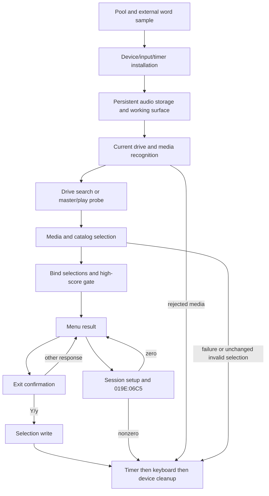

# Main orchestration and ownership review

P1-05 static review of `0000:[07B3,0C04)`. [Machine-readable evidence](evidence/td2ega-main-review-v2.json) records fourteen reviewed regions, every discovered branch and explicit memory write, and39 selected instruction checks against the admitted image. Main has360 instruction locations and56 call sites. This is a control/ownership review; its callees, complete state validation and portable main C remain open.

The diagram summarizes named paths; exact conditions and retry edges are in the evidence. It does not prove that session entry is playable or that every state reaches cleanup.

`07C8` initializes resource storage through `6F86`, whose literal end request is segmentA000h. `6F1E` stores CS/DS, conditionally requests DOS allocation of64h paragraphs, saves returned AX as the left boundary, and executes DOS resize AH4Ah **twice**. There is no local carry branch after allocation or either resize. It derives the right boundary from saved base plus the resulting BX, resets active/cached pointers, and clears only interior statuses. It does not recreate all sentinel fields or clear stale names/sizes. Platform return/error effects and the size retained in BX must be preserved in P1-07; neither the literalA000h nor a plausible allocation can substitute for those contracts.

Main installs the input callback, keyboard vectors09/16 and timer08, then registers music callback75EA before acquiring the voices/song storage. Raw far pairs remain at942A/C and8640/2 and feed audio consumers. Startup's initialization/enable flags and interrupt lifetimes must establish that a callback cannot consume an unready pointer; registration order alone does not prove that. B0FE is called with320,200 and0Fh and returns the working surface at8CA2/4. Its exact plane/header and later release ownership remain presentation contracts.

Drive/media discovery uses a stack-local drive word, `05C0` disk-ID recognition, tables at DS0040 and8A1C, media selector8CFC/8A8C and the probe of external `testdrv2.pes`. The probe uses a runtime stream, closes it, and does not decode the resource. Drive iteration is signed; table indexing and the runtime drive domain must prevent near-offset wrap/alias. A zero near argv[1] remains a machine DS:0000 reference rather than host NULL.

The two media-ready paths differ. The initial call to `0477` is checked for AX=1 and otherwise exits. At `09D5`, the retry path compares AX with1, but `09D8` unconditionally jumps to `09FB`; that skipped span is not reached by the current main graph. `09FB` decrements the helper's returned AX and stores it at5657, whereas the first path stores drive-minus-one. Preserve this supplied-image control flow; no source-level success check or historical patch explanation has been inferred.

Physical086Ch samples/differences are stored and accumulated modulo65536. Main compares the accumulator unsigned with literal500 before setting group007C. The confirmation input call receives a long-valued literal3000. These are exact argument/branch observations with **no admitted clock unit or frequency**. The reviewed41 syntactic CS-prefixed writes have no direct literal overlap with the external-reader or physical0086h-write code spans. Indexed CS writes, DS/ES aliases and undiscovered paths remain open, so this is not proof that the code can never be modified.

Catalog selection populates8A7A/90AA; selected names/records are bound by near helpers0651/0730, and0645:0000 supplies a gate before the menu/session loop. `019E:06C5` returns zero to the menu and nonzero to cleanup; its nested session semantics and timer-driven simulation remain separate. The confirmation recognizes1Bh for retry and59h/79h for the write/exit branch. The labels in the diagram are supported by the external prompt's consumer context, without embedding that original text in C.

Cleanup calls timer restoration610A, then keyboard restoration68C4, then one of5FBC/642E. Main returns whatever AX the final helper leaves; it has no explicit constant-zero return. Fatal-handler paths and process-level runtime finalizers are separate from this main epilogue.

The [60-site cache caller inventory](evidence/td2ega-cache-callers-v1.json) verifies four allocator, four acquire, nine fast-release, thirty-eight shifting-release and five discard call encodings and stable IDs. Nearby pushes and immediate cleanup are syntactic context, not complete argument/lifetime proofs. All caller ownership, descriptor-space exclusions, packed-loader coupling, complete transition/resource writes and shared byte-source reset/interrupt ordering remain open before P1-05/P1-GATE closure. No DOS session, full codec, renderer, audio output, Windows gameplay, CGA or Amiga recovery is admitted here.

Main-called13A8:002E is a self-modifying platform helper, not ordinary immutable runtime scaffolding. [The mutable helper review](td2ega-mutable-platform.md) identifies DS/ES aliases and distinguishes the CLC/RETF tail states. [224 retry composition cases](evidence/td2ega-retry-mutator-context-v1.json) execute09D2 through0A04 plus actual002E with synthetic0477 return AX andINT11 responses.09D8 unconditionally skips any CMP-dependent decision; AX1 becomes selectedword0 and installsCB/75/75/75, withDS007C0. Actualfile success/history is not established.

[Session resource review](evidence/td2ega-session-resource-review-v1.json) records the ten farpair clears, releaseorder, stale globals and optional SGN/font branch. The7774-byte DAT copy intoDS346A..52C7 aliases52C2/52C4; absolute direct-writer scans alone cannot prove ownership. Shared lifetime and interprocedural register liveness remain open.
